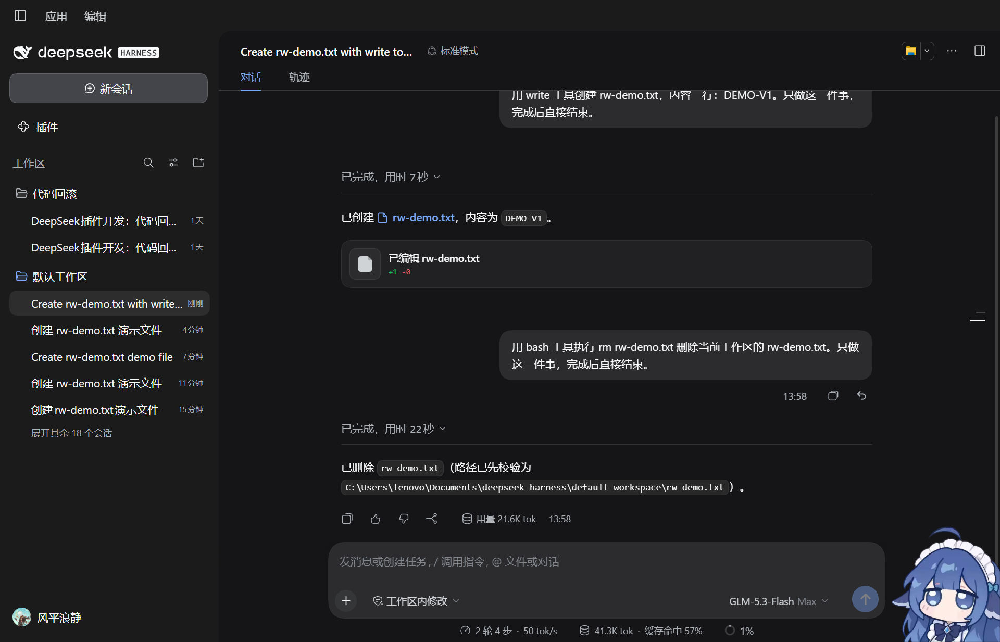
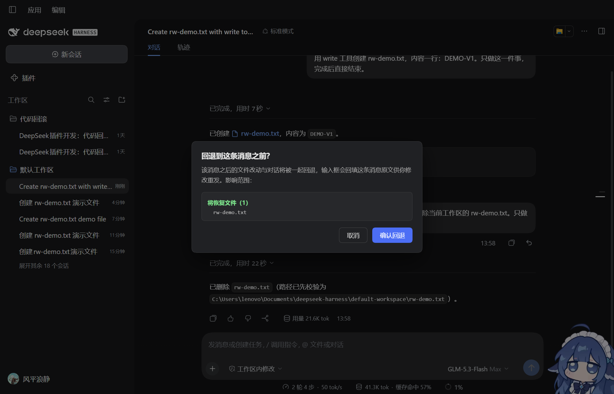
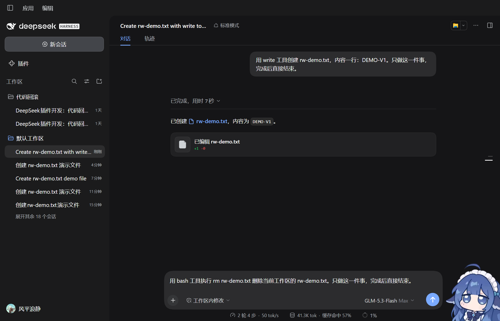
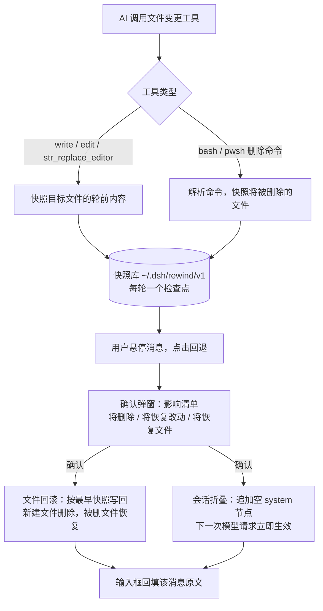

# dsh-rewind

[](./LICENSE)


DeepSeek Harness 桌面端的"代码回滚 + 会话回滚"插件：悬停任意用户消息即可一键回退，把**文件改动**和**模型上下文**一起退回到这条消息之前，消息原文自动回填输入框供你修改重发。快照式实现，**完全不碰 git**。

## 效果预览

| 悬停消息 → 回退按钮 | 回退前弹影响清单 | 确认后：折叠 + 回填 + 文件恢复 |
| --- | --- | --- |
|  |  |  |

> 上图为真实操作截图：AI 用 `rm` 删除了 `rw-demo.txt`，悬停该条消息点击回退，弹窗明确提示"**将恢复文件（1）**"，确认后文件原样恢复、该轮对话折叠、输入框回填原文。

## 功能特性

- **悬停回退按钮**：在每条用户消息的操作行自动注入原生风格的"回退"按钮，点哪里退哪里
- **影响清单确认弹窗**：回退前列出将受影响的文件，按三类分组展示——**将删除**（AI 新建的文件）、**将恢复改动**（被修改的文件）、**将恢复文件**（被删除的文件），确认后才执行
- **文件回滚**：被修改的文件还原为该轮之前的内容；AI 新建的文件被删除；被 AI 删除的文件原样恢复
- **会话回滚**：模型上下文同步折叠，AI 不再"记得"被撤销的对话，对下一次模型请求立即生效
- **输入框回填原文**：被回退消息的完整原文自动填入输入框，可直接修改重发
- **bash / pwsh 删除命令的文件也可恢复**：`rm`、`Remove-Item` 等删除命令执行前会对目标文件快照，被删文件回滚时原样写回
- **不碰 git**：快照式实现，不提交、不暂存、不改 `.git`，非 git 目录也能用
- **对话式回滚**：内置 `rewind_list` / `rewind_restore` 模型工具，直接对 AI 说"回滚到上一步"即可（`code` / `conversation` / `both` 三种范围可选）

## 安装

要求：DeepSeek Harness 桌面端（Windows），且 `pnpm` 可用（插件安装走 pnpm）。

**方式一（推荐）：从 Git 仓库安装**

在 DeepSeek Harness 桌面端的"插件"页选择"从 Git 仓库安装"，填入本仓库地址；或用 CLI 执行：

```powershell
dsh plugin add <本仓库 Git 地址>
```

**方式二：从本地路径安装**

先把本仓库克隆到本地，然后在插件页选择"从本地路径安装"，指向克隆后的仓库目录：

```powershell
git clone <本仓库 Git 地址>
```

加载成功的标志：启动日志出现 `[dsh-rewind] 已加载（代码回滚 + 会话回滚）`。

## 工作原理

1. **工具执行前快照文件**：`write` / `edit` / `str_replace_editor` 按路径参数快照目标文件；`bash` / `pwsh` 解析删除类命令（`rm`、`del`、`Remove-Item` 等）并快照将被删除的文件。每个用户轮次一个检查点，同一轮内同一路径只记录轮前状态，原子写入本地快照库 `~/.dsh/rewind/v1/<工作区哈希>/<会话ID>.json`。
2. **回退时按最早快照恢复文件并删除新建文件**：取目标轮（含）之后的所有检查点，同一路径取最早一份快照——修改的文件写回轮前内容，被删的文件原样写回，新建的文件删除；恢复操作严格限制在工作区根内。
3. **会话折叠通过向会话日志追加一条空 system 节点的 surface replace 完成**：该节点不投影任何消息，模型历史与界面同时清除目标轮及之后的内容，与官方 compaction 同机制，对下一次模型请求立即生效。



## 注意事项与限制

- 快照式回滚**不执行任何 git 操作**（不提交、不暂存、不改 `.git`），也不会回退你的 git 提交。
- **会话回滚在下一次请求生效**：当前轮进行中发起的回滚，会在该回合结束后（发送下一条消息时）自动完成；文件回滚则立即生效。
- **误回退无法一键撤销**：被删除的"新建文件"不会进回收站。重要改动请先自行提交 git 或手动备份。
- 目前仅支持 **Windows + DeepSeek Harness 桌面端**。
- **插件升级需卸载后重装**（桌面端限制）。
- 工具追踪覆盖 `write` / `edit` / `str_replace_editor` / `bash` / `pwsh`，未列出的写入类工具不会生成快照（可在插件配置 `trackedTools` 中追加）。
- bash/pwsh 删除追踪基于命令解析，通配符批量删除、脚本间接删除可能漏追踪。
- 单文件快照上限 5MB，超限记为 skip，恢复时跳过该文件。

## 常见问题

**Q：回退后想撤销怎么办？**
A：没有自动撤销。被还原的文件需要手动改回，被删除的文件可以尝试从系统回收站或你自己的备份找回。建议重要改动先提交 git 再让 AI 继续。

**Q：它会回退我的 git 提交吗？**
A：不会。插件完全不读写 git，只按自己的快照恢复文件。

**Q：支持哪些模型？**
A：模型无关。回滚逻辑只依赖宿主的会话与工具事件，GLM、DeepSeek 等模型均可使用。

## 开发

```powershell
npm install
npm test    # 运行单元测试（node --test "test/*.test.mjs"，23 个用例）
```

目录结构：

| 路径 | 说明 |
| --- | --- |
| `lib/index.js` | 插件入口：事件订阅、工具注册、REST 路由与 UI 注入 |
| `lib/capture.js` | 会话跟踪与文件快照捕获 |
| `lib/service.js` | 服务编排：检查点查询、回滚执行、延迟会话折叠 |
| `lib/restore.js` | 恢复引擎：文件回写、会话折叠、diff 计算 |
| `lib/store.js` | 快照存储：原子落盘、保留期/总量清理 |
| `lib/tools.js` | 模型工具定义（`rewind_list` / `rewind_restore`） |
| `lib/webui.js` | REST 路由 + 消息级回退按钮 / 悬浮面板注入 |
| `lib/util.js` | 路径解析、原子写、哈希等工具函数 |
| `client.js` | 桌面端客户端插件占位（UI 由服务端注入） |
| `cordis.patch.yml` | bundle 挂载声明 |
| `test/` | 单元测试 |

## 许可证

[MIT](./LICENSE)
